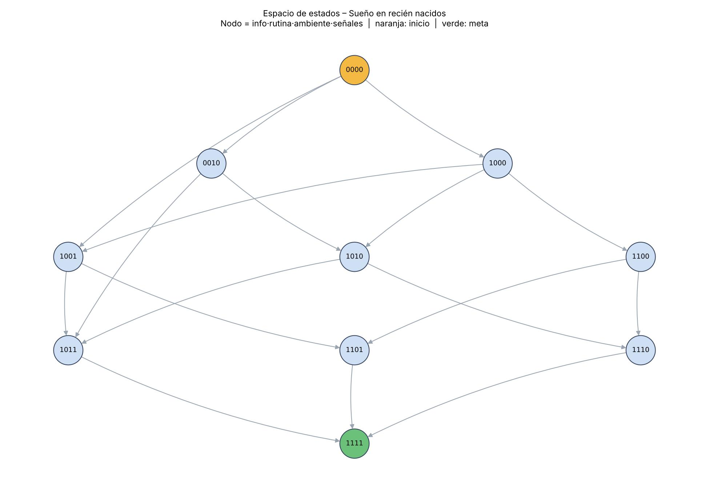

# Espacio de Estados – Caso Tipo C: Sueño en los Recién Nacidos

**Objetivo:** representar formalmente el problema como un espacio de estados sobre el que una IA pueda explorar y buscar soluciones.

## 1. Idea general

Un bebé (0–3 meses) tiene un sueño fragmentado e impredecible. La infografía propone medidas que las familias pueden aplicar: **información y acompañamiento**, **establecimiento de rutinas**, **comprensión de señales de cansancio** y un **ambiente de sueño adecuado**. El problema se modela como: _¿qué secuencia de acciones, y a qué costo, lleva de un patrón de sueño desorganizado a uno consolidado?_

> Nota: el modelo es conceptual y orientativo. La infografía indica explícitamente que **no se reporta** la efectividad comparativa de cada intervención, por lo que los costos de cada operador son supuestos didácticos (esfuerzo relativo para la familia), no resultados científicos.

## 2. Estados

Un estado es una tupla de 4 variables binarias (0 = no, 1 = sí):

`s = (info, rutina, ambiente, señales)`

| Variable | Significado | Relación con la infografía |
|---|---|---|
| `info` | La familia cuenta con información y acompañamiento (profesionales de salud, guías) | Intervención: "información y acompañamiento para las familias" |
| `rutina` | Existe una rutina de sueño establecida | Intervención: "establecimiento de rutinas" |
| `ambiente` | El ambiente de sueño es adecuado (tranquilo, ventilado, ubicación segura del sueño) | Variable observable: ubicación del sueño |
| `señales` | La familia reconoce las señales de cansancio del bebé | Intervención: "comprensión de señales de cansancio" |

- **Espacio total:** 2⁴ = **16 estados**.
- **Estado inicial:** `(0,0,0,0)` – sin información, sin rutina, ambiente no adecuado, señales no reconocidas (sueño fragmentado).
- **Estado meta:** cualquier estado con `rutina = 1`, `ambiente = 1` y `señales = 1` (sueño más consolidado). Por la restricción de dependencia de información, el único estado meta alcanzable es `(1,1,1,1)`.
- **Estados alcanzables:** de los 16 estados posibles, **10** son alcanzables desde el estado inicial (por ejemplo, `(0,1,0,0)` nunca ocurre porque la rutina exige información previa).

## 3. Operadores (acciones)

| Operador | Precondición | Efecto | Costo |
|---|---|---|---|
| O1: Buscar información y acompañamiento | `info = 0` | `info = 1` | 1 |
| O2: Establecer rutina de sueño | `info = 1` y `rutina = 0` | `rutina = 1` | 2 |
| O3: Adecuar el ambiente de sueño | `ambiente = 0` | `ambiente = 1` | 1 |
| O4: Aprender señales de cansancio (por cuenta propia) | `info = 1` y `señales = 0` | `señales = 1` | 1 |
| O5: Consulta con profesional de salud | `info = 0` | `info = 1` y `señales = 1` | 3 |

## 4. Restricciones

1. **Dependencia de información:** establecer rutina (O2) y aprender señales (O4) requieren haber obtenido información antes (`info = 1`).
2. **Sin retroceso:** dentro del horizonte del problema, una vez logrado algo no se pierde (los operadores solo cambian 0 → 1).
3. **Costo positivo:** cada acción tiene un costo ≥ 1 (esfuerzo/tiempo de la familia).
4. **Alcance:** el modelo no reemplaza la evaluación pediátrica y no establece causalidad (la infografía lo señala como no reportado).

## 5. Representación visual

_(El diagrama muestra los 10 estados alcanzables agrupados por número de medidas logradas. Cada nodo se rotula `info·rutina·ambiente·señales`.)_

## 6. Función heurística (para A*)

`h(s) = (nº de variables meta aún en 0) + (1 si info = 0 y falta rutina o señales)`

- **Admisible:** nunca sobreestima el costo real restante, porque cada acción necesaria cuesta al menos 1 por cada mejora que aporta (O5 cuesta 3 y aporta 2).
- **Consistente:** cada operador reduce `h` en un valor menor o igual a su costo.

## 7. Resultado esperado de la búsqueda

| Estrategia | Criterio | Plan encontrado | Costo |
|---|---|---|---|
| BFS | Menor número de pasos | O3 → O5 → O2 (3 pasos) | 6 |
| Costo uniforme (Dijkstra) | Menor costo | O1 → O3 → O4 → O2 (4 pasos) | **5** |
| A* con `h(s)` | Menor costo guiado por heurística | O1 → O3 → O4 → O2 (4 pasos) | **5** |

Las tres estrategias expanden los 10 nodos alcanzables (el espacio es pequeño). Esto muestra una idea clave: **menos pasos no siempre significa menor costo**. La ventaja de una heurística como la de A* en reducir nodos explorados se aprecia en espacios más grandes.
